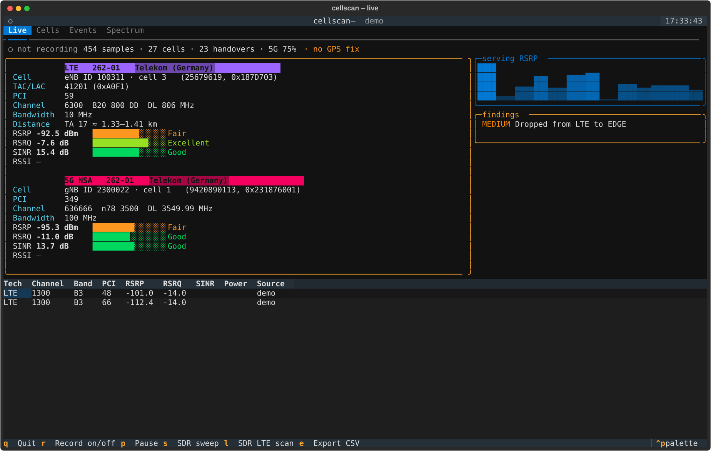
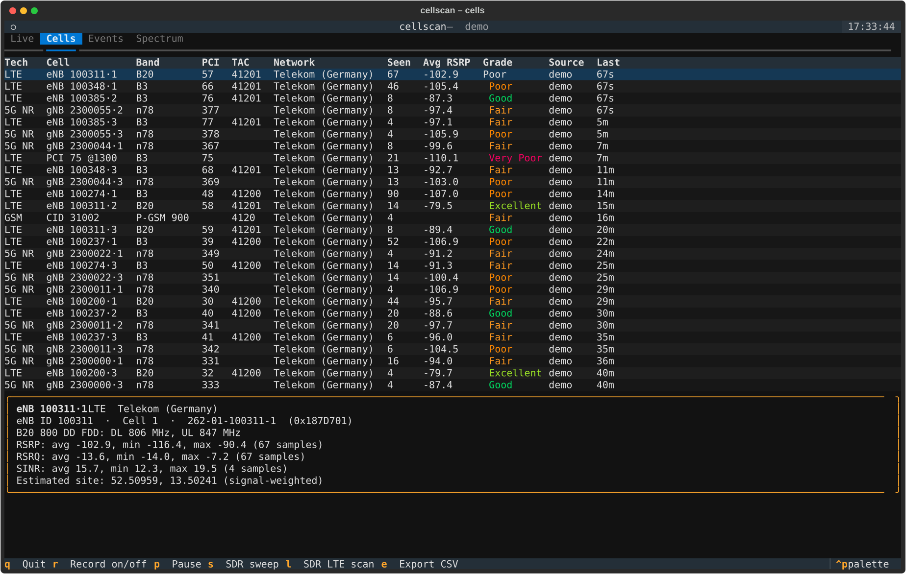
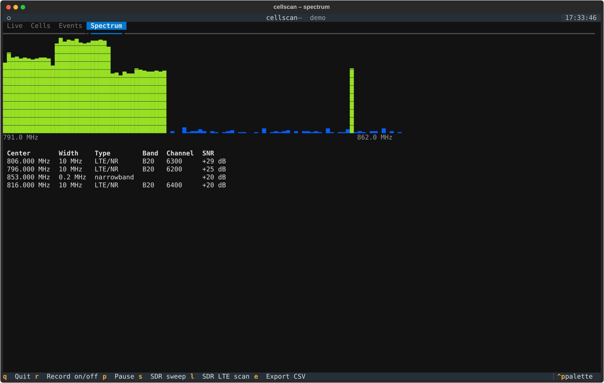

# cellscan

**Passive cell-tower analyzer for Linux terminals.** It reads the serving and neighbouring cells from your
laptop's built-in WWAN modem, tags them with GPS, and uses an external SDR (RTL-SDR, HackRF or any
SoapySDR device) to sweep the spectrum and find LTE cells on its own. It also decodes what it sees and
flags patterns typical of fake base stations ("IMSI catchers").

Built for Kali Linux, and works on any modern Debian/Ubuntu. Python 3.10+.



## What it does

| | |
|---|---|
| **Laptop modem** | Serving and neighbour cells (PLMN, TAC, cell ID, PCI, EARFCN/NR-ARFCN, RSRP/RSRQ/SINR, timing advance). Readers for ModemManager, Qualcomm QMI and Quectel `AT+QENG`. Handles 5G NSA (LTE anchor + NR leg) and SA. |
| **GPS** | gpsd (the modem's GNSS or a USB receiver), or a fixed position |
| **SDR – spectrum** | `rtl_power` / `hackrf_sweep` / `soapy_power` sweeps. Detects carriers and maps them to band and EARFCN/ARFCN. |
| **SDR – LTE cell search** | Built-in PSS/SSS detection in NumPy. Finds PCI, frame timing, frequency offset and SNR from raw IQ, with no extra tools. |
| **SDR – external scanners** | Wrappers for kalibrate-rtl (`kal`), gr-gsm (`grgsm_scanner`, GSM cell identities from broadcast), srsRAN (`cell_search`, LTE incl. MIB) and LTE-Cell-Scanner |
| **Analysis** | Band and frequency decoding (LTE/NR/UMTS/GSM), eNB/gNB IDs, signal grades, handovers, time per technology. Also signal-weighted site estimates, distance from timing advance, and OpenCellID lookups. |
| **Security checks** | Test PLMNs (001-01, 999-99), unallocated MCCs, drops to 2G, a cell ID reused with a different PCI/channel/TAC, brief tracking-area switches, PCI collisions nearby, unusually strong signals, cells far from their registered site |
| **Data** | Sessions as JSON Lines; export to CSV, JSON and KML; import of exports from the iOS *Cell Analyzer* app |

### Passive only

cellscan only **receives** what cells broadcast to everyone (synchronisation signals and broadcast
system information) and what your own modem reports about its own connection. It never transmits. It
doesn't decode other people's traffic or signalling, and it captures no subscriber identities (IMSI/TMSI).
Receiving cellular bands is still regulated in some countries, so check your local law before using an SDR.

## Install

### Kali / Debian (recommended)

```sh
git clone https://github.com/gspnst/cellscan.git && cd cellscan
./scripts/install-kali.sh        # apt tools + pipx install (add --minimal to skip GSM scanners)
cellscan doctor                  # shows what is available and how to fix the rest
```

### Manual

```sh
sudo apt install pipx modemmanager libqmi-utils gpsd gpsd-clients rtl-sdr hackrf soapysdr-tools python3-soapysdr
pipx install --system-site-packages git+https://github.com/gspnst/cellscan.git
```

`--system-site-packages` lets cellscan use Kali's `python3-soapysdr` bindings. Optional extras:
- `kalibrate-rtl` and `gr-gsm` from apt;
- srsRAN 4G (`cell_search` from `lib/examples`) and LTE-Cell-Scanner, both built from source;
- `pip install 'cellscan[serial]'` for direct AT-port access.

To try it without any hardware:

```sh
cellscan demo            # synthetic 40-minute drive → analysis
cellscan demo --live     # same data replayed in the dashboard
```

## Quick start

```sh
# 1. One-time ModemManager setup: enable 3GPP location + extended signal reporting
sudo cellscan modem --setup

# 2. Live dashboard, recording a session, with GPS from gpsd
cellscan monitor --session commute

# 3. Afterwards
cellscan analyze latest                       # summary, cells, security checks
cellscan export latest -f kml -o commute.kml  # open in Google Earth
cellscan lookup latest --key $OPENCELLID_KEY  # registered tower positions (optional)
```

### Dashboard keys

| Key | Action |
|---|---|
| `s` | SDR power sweep of `--band` (needs `--sdr`) |
| `l` | SDR LTE cell search on the swept carriers |
| `r` | pause/resume recording |
| `p` | pause polling |
| `e` | export the session to CSV |
| `q` | quit |

Tabs: **Live** (serving cell, signal gauges, RSRP history, neighbours, findings) · **Cells** · **Events**
(findings and the handover/technology timeline) · **Spectrum**.

## SDR only (no modem, no GPS)

Everything SDR-related works without a modem or GPS:

```sh
cellscan doctor                                        # is the SDR detected?
cellscan sweep --sdr rtlsdr --band B20                 # which LTE carriers are on air (≈10 s)
cellscan lte-scan --sdr rtlsdr --band B20 --guided     # sweep, then decode PCIs on those carriers
cellscan monitor --source none --gps none --sdr rtlsdr --band B20   # dashboard: press s, then l
```

- **Frequency error:** RTL-SDR dongles without a TCXO are often 30–60 ppm off. If the sweep shows
  carriers but `lte-scan` decodes nothing, add `--max-cfo 60`, or measure the error with `kal` and pass
  `--ppm`. RTL-SDR Blog V3/V4 and HackRF with a TCXO don't need this.
- **What the SDR can tell you about LTE:** carrier frequency and band, PCI, timing, SNR and relative
  power. Operator, TAC and cell ID live in SIB1, which cellscan doesn't decode, so they need the modem
  (or srsRAN tools). For GSM, `gsm-scan --tool grgsm` reads MCC/MNC/LAC/CID from broadcast.
- **Location:** without GPS, `--gps LAT,LON` tags saved results with a fixed position, e.g. your home.

## Modem sources

```sh
cellscan modem                                # ModemManager (default)
cellscan modem --source qmi                   # Qualcomm QMI via qmi-proxy: richest neighbour data
cellscan modem --source quectel               # AT+QENG through ModemManager (start MM with --debug)
cellscan modem --source quectel --at-port /dev/ttyUSB2   # AT port directly (pip install pyserial)
cellscan monitor --source mm,qmi              # combine sources
```

Notes:
- ModemManager only returns location and extended signal values after `--setup`, which runs
  `mmcli --location-enable-3gpp` and `--signal-setup`. This may need root or a polkit rule.
- `--get-cell-info` (neighbour list) needs ModemManager ≥ 1.20 and modem support. cellscan falls back
  to location + signal when it's unavailable.
- Laptop modems that work well include Quectel EM05/EM12/EM120/RM5xx, Fibocom L850/L860/FM350 and
  Sierra EM74xx/EM75xx. Intel/Fibocom XMM modems expose less via QMI/MBIM.

## SDR

```sh
# Spectrum: which carriers are on air in band 20?
cellscan sweep --sdr rtlsdr --band B20
cellscan sweep --sdr hackrf --start 2110M --stop 2170M --bin 200k

# LTE cell search (PSS/SSS) – whole band, specific channels, or an IQ recording
cellscan lte-scan --sdr rtlsdr --band 20 --step 2
cellscan lte-scan --sdr soapy:driver=hackrf --earfcn 6200,6300,6400 --save b20
cellscan lte-scan --iq capture.cu8 --rate 2.4M       # e.g. from `rtl_sdr -f 806e6 -s 2.4e6 -n 500000 capture.cu8`

# GSM with broadcast identities (MCC/MNC/LAC/CID), and srsRAN's MIB-decoding search
cellscan gsm-scan --tool grgsm --band GSM900 --save gsm
cellscan gsm-scan --tool kal                          # also gives the dongle's ppm error
cellscan srsran-scan --band 20

# Dashboard with SDR actions enabled
cellscan monitor --sdr rtlsdr --band B20 --ppm 2
```

Frequency coverage: an RTL-SDR reaches ~24–1766 MHz, which covers GSM900, LTE B8/B20/B28 and parts of
B3. Use HackRF, bladeRF, LimeSDR or USRP for 1.8–2.7 GHz and 5G n78 (sweeps work there; LTE cell search
covers LTE only).

### How the built-in LTE cell search works

1. Captures 30 ms of complex baseband at 1.92 Msps, centred on the EARFCN.
2. Correlates against the three PSS Zadoff-Chu replicas (TS 36.211 §6.11.1) over a ±20 kHz frequency
   offset grid, averaging over the 5 ms half-frames → N_ID_2, timing, coarse CFO.
3. Refines the CFO from the phase drift across the PSS.
4. Takes the SSS symbol before each PSS and equalises it with a smoothed PSS channel estimate
   (maximum-ratio combining). Tests all 168 N_ID_1 values × subframe 0/5 → N_ID_1 and frame timing.
5. Accepts a cell only when the SSS decision is unambiguous and fits after equalisation. This rejects
   PSS sidelobes and the Zadoff-Chu timing/frequency ambiguity.

In synthetic tests it detected 40/40 random cells at 0–10 dB SNR with ±15 kHz offsets, with no false
PCIs, and it separates unsynchronised cells down to −6 dB relative power. It decodes **no** further
channels (MIB/SIBs need srsRAN). Real-world performance depends on your SDR's frequency accuracy: set
`--ppm` (measure it with `kal`).

## Security checks

| Finding | Why it matters | Innocent explanations |
|---|---|---|
| Test network (001-01, 999-99) | Lab PLMNs, common on cheap simulators | Lab or test equipment nearby |
| Unallocated MCC | No real network uses it | Decoding error |
| 4G/5G → 2G drop | 2G has no network authentication | Poor coverage – check whether it repeats at the same place |
| Cell ID reused with a different PCI/channel | A spoofed copy of a real cell | Network re-planning |
| Cell changed TAC/LAC | Forces location updates | Re-planning |
| Brief A→B→A tracking-area switch | Luring phones into a location update | Border between areas |
| Same channel + PCI from two cells < 2 km apart | Phones can't distinguish them | Planning error |
| RSRP > −50 dBm | Transmitter very close | Small cell or indoor system |
| Cell far from its registered site / not in database | Identity broadcast elsewhere | Outdated database |

These are heuristics: one finding alone rarely means anything. Several close together in time and place
are worth a closer look.

## Commands

```
cellscan doctor          check tools, SDR hardware, modem, gpsd, permissions
cellscan modem           one-shot serving/neighbour readout (--json, --save NAME, --setup)
cellscan monitor         live dashboard (--session NAME records; --no-tui for plain lines)
cellscan sweep           SDR power sweep + carrier detection (--csv to analyse a saved sweep)
cellscan lte-scan        native LTE cell search (SDR or --iq file)
cellscan gsm-scan        kal / grgsm_scanner
cellscan srsran-scan     srsRAN cell_search
cellscan sessions        list recordings (~/.local/share/cellscan/sessions)
cellscan analyze [S]     summary, cells, findings (--json)
cellscan export [S]      -f csv|json|kml [-o FILE]
cellscan import FILE     JSON export (also from the iOS Cell Analyzer app)
cellscan lookup [S]      OpenCellID lookups (--key or CELLSCAN_OPENCELLID_KEY)
cellscan decode FAMILY   --cell-id, --channel, --pci helpers
cellscan demo            synthetic data (--live for the dashboard)
```

Global option: `--gnb-bits 22..32` sets how a 5G NCI is split into gNB and cell ID (operator-specific;
the default is 24). Environment variables: `CELLSCAN_HOME` (data directory), `CELLSCAN_OPENCELLID_KEY`,
and `CELLSCAN_DEBUG=1` for tracebacks.

## Development

```sh
python3 -m venv .venv && . .venv/bin/activate
pip install -e ".[dev]"
pytest -q && ruff check src tests scripts
python scripts/screenshots.py      # regenerate docs/*.svg from demo data
```

Layout:

```
src/cellscan/
  models.py analysis.py spectrum.py identity.py signal.py geo.py operators.py export.py store.py engine.py
  sources/   modemmanager.py qmi.py quectel.py gps.py
  sdr/       capture.py lte_sync.py lte_scan.py sweep.py external.py
  tui/       app.py
  cli.py demo.py doctor.py opencellid.py
```

The modem and scanner parsers are tested against sample outputs modelled on each tool's documented
format. If your modem prints something different, run with `--json` or `CELLSCAN_DEBUG=1` and open an
issue with the raw output.

| Cells | Spectrum |
|---|---|
|  |  |

## License

MIT
